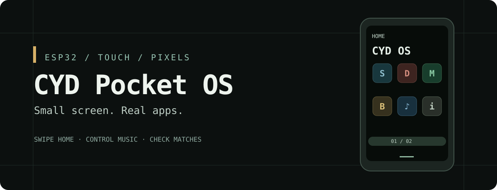
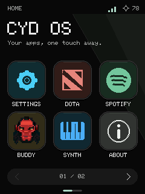

<p align="center"></p>

<p align="center">
<a href="https://github.com/ShiroPpu69/cyd-pocket-os/actions/workflows/firmware.yml"></a>


<a href="LICENSE"></a>
</p>

<p align="center"><b>A pocket-sized touchscreen desktop for the ESP32 Cheap Yellow Display.</b><br>Swipe home. Control music. Check matches. Make noise. Add your own app.</p>

<p align="center"><a href="README.zh-CN.md">简体中文</a> · <a href="docs/GETTING_STARTED.md">Build & flash</a> · <a href="esp32_system/APP_CONTRACT.md">Add an app</a> · <a href="CONTRIBUTING.md">Contribute</a></p>

## One little board. A surprisingly useful desk companion.

CYD Pocket OS turns an **ESP32-2432S028R** into a portrait-mode, touch-first app launcher. It is an Arduino firmware shell, **not an Android port**. Native RGB565 drawing and pixel fonts, designed for a 240 × 320 screen and a board without PSRAM.

<p align="center"></p>
<p align="center"><sub>Host-rendered launcher design preview, not a photograph of the LCD. Deadlock lives on page two.</sub></p>

### Inside the launcher

| App | What it does |
| --- | --- |
| **Spotify remote** | Artwork, artist/album/track information and progress. Portrait MP3-player controls for previous/next, volume and play/pause; playlist and track selection. Controls another Spotify device; it does not stream audio on the ESP32. |
| **Dota match history** | Recent results with hero portraits, backed by OpenDota. |
| **Deadlock match journal** | Latest 10 recorded matches, four cards per page: hero, outcome, K/D/A, duration, UTC+8 start time and final personal soul value (`net_worth`, not unspent balance). Community API, not Valve's official API. |
| **Buddy** | Animated pixel companion with encrypted BLE/NUS messaging, inspired by Codex Buddy. Current artwork is an Axe-inspired character. |
| **Synth** | Touch synthesizer using ESP32Synth and the board's GPIO26 DAC/speaker path. Start with a low volume. |
| **Settings** | Persistent brightness and English / 简体中文 preferences. Individual apps still contain English labels. |

### The little details matter

- **A home gesture everywhere.** Swipe up from the bottom edge to leave an app. The shell owns navigation.
- **Room to grow.** Six icons per page; append another app to the registry to expand the launcher.
- **Network work stays off the UI thread.** Bounded jobs, cancellation, control prioritization and shared TLS transport separate expensive requests from touch handling.
- **Memory-conscious rendering.** Small artwork, Flash-resident hero portraits, native drawing and no full-screen launcher sprite.
- **Diagnostics included.** Heap checks, watchdog protection, download self-tests and scripted app-transition tests. Safeguards, not a promise of zero freezes.

## Get running

**Hardware:** ESP32-2432S028R (resistive XPT2046 touch, ILI9341, 4 MB Flash). Other CYD revisions need pin/driver changes; capacitive-touch variants are not drop-in replacements.

```sh
git clone https://github.com/ShiroPpu69/cyd-pocket-os.git
cd cyd-pocket-os
```

Install Arduino CLI, the ESP32 core and the libraries in [the setup guide](docs/GETTING_STARTED.md). Copy the two example configuration headers to their local names, enter **your own** credentials, then:

```sh
arduino-cli compile --jobs 4 --fqbn esp32:esp32:esp32:PartitionScheme=huge_app esp32_system
arduino-cli upload -p YOUR_SERIAL_PORT --fqbn esp32:esp32:esp32:PartitionScheme=huge_app esp32_system
```

The 3 MB application layout leaves no OTA dual-image slot. Tap the four calibration targets on first boot. Swipe left/right to change launcher pages; swipe up from the bottom edge to return home.

## Honest project status

Working hobby firmware, not a certified product. The stability baseline completed **120 automated app transitions** without a captured crash or exit timeout; the newer Deadlock UI passed a further **24-transition** regression and three-page navigation/data checks on one board. Tests were serial-driven, not a touchscreen robot. Successful Spotify skip latency was not established by those runs. BLE desktop interoperability and audible audio quality need wider testing.

Spotify requires your own developer application and an active compatible playback device; playback controls require Premium. API access policies and data coverage can change; some games may be missing. **HTTPS currently uses `setInsecure()`**, so certificates are not verified: treat this as a trusted-network prototype, not secure credential storage. Firmware embeds configured secrets; never share a personal build. See [Security](SECURITY.md).

## Build the next app

Start with [the app contract](esp32_system/APP_CONTRACT.md) and `deadlock_app.cpp`. Keep drawing on the UI thread, put slow work in bounded background jobs, cancel safely on exit and register the icon in `home_apps.h`. The shell handles the return gesture.

Useful next contributions: certificate validation, configurable timezones, playlist/device diagnostics, more board profiles, accessibility and language coverage. Open an issue before a large redesign.

If this makes your CYD more useful, a star helps other builders discover it. Photos of real builds, reproducible bug reports and small PRs are even better.

## Credits & licensing

Original code is MIT-licensed. Vendored code retains its notices. Game artwork, characters, names and logos are **not** relicensed under MIT; see [third-party notices](THIRD_PARTY_NOTICES.md). Not affiliated with Valve, Spotify, OpenAI or upstream projects.

Built on [LovyanGFX](https://github.com/lovyan03/LovyanGFX), [ArduinoJson](https://github.com/bblanchon/ArduinoJson), [NimBLE-Arduino](https://github.com/h2zero/NimBLE-Arduino), [JPEGDEC](https://github.com/bitbank2/JPEGDEC) and [AnimatedGIF](https://github.com/bitbank2/AnimatedGIF). Music integration draws on [Spotify-Diy-Thing](https://github.com/witnessmenow/Spotify-Diy-Thing) and [spotify-api-arduino](https://github.com/witnessmenow/spotify-api-arduino); synth code comes from [ESP32Synth](https://github.com/danilogcrf2-oss/ESP32Synth). Companion protocol inspiration: [Codex Buddy](https://github.com/openelab-commits/codex-buddy). Match data: [OpenDota](https://docs.opendota.com/) and [Deadlock API](https://api.deadlock-api.com/docs).
